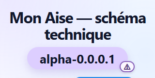

# TG-005b — Identité locale et signal de lecture partielle

Mon Aise reste le spécimen ouvert par l’index, avec `alias: "mon_aise"`. Les deux fiches utilisent toujours le contrat 0.1.2.

## Recette par HTTP local

Depuis la racine du dépôt, la commande suivante sert le prototype sur la boucle locale. [Ouvrir Mon Aise sur le port 8000](http://127.0.0.1:8000/protocole_mon_gpt_alpha/index.html).

```powershell
python -m http.server 8000 --bind 127.0.0.1
```

En ouverture directe depuis le disque, tenter de charger une image absente contraint le navigateur à chercher le fichier. Edge signale alors `ERR_FILE_NOT_FOUND`. Le test HTTP préalable a montré qu’un `HEAD` sur le PNG manquant renvoie bien 404, mais qu’Edge journalise aussi ce statut comme une erreur réseau.

En HTTP, le renderer lit donc la page du répertoire `../assets/` produite automatiquement par le serveur Python et y cherche le lien exact `<alias>.png`. Il crée l’image uniquement si ce lien existe. Déposer le PNG suffit. Cette solution utilise la liste de répertoire fournie par le serveur statique. Elle ne demande aucun inventaire à maintenir, aucun manifeste et aucun champ de présence. Le mode fichier conserve le comportement de TG-005a. La recette silencieuse s’effectue par HTTP.

## Languette

En lecture partielle, une petite languette à contour violet chevauche le bord inférieur droit de la pastille de version. Son seul caractère visible est ⚠. Son nom accessible est « Lecture partielle ». Le positionnement conserve la hauteur du bandeau. Une fiche dépourvue de version peut toujours porter le signal sans créer une pastille de version vide.



## Vérifications dans Edge

| Cas | Résultat observé par HTTP |
| --- | --- |
| Mon Aise publié | Le PNG de l’alias est absent. La fiche affiche trois technologies, quatre familles et les commandes technologies, données et réinitialisation. Aucun emplacement de mascotte, flux ou ⚠. |
| Clé temporaire `socle_technique.canexistepas` | Les trois cartes restent identiques. Seule la languette apparaît. À 1448, 390 et 320 px, elle chevauche la pastille, reste dans la largeur disponible et ne touche pas le titre. La hauteur du bandeau est identique avant et après. |
| Mon GPT<3 | Le PNG `mon_gpt.png` est chargé et décodé. Renommer le sujet en mémoire conserve la même image. Le Collector, le navigateur, les deux flux et les quatre commandes fonctionnent. Aucun ⚠. |
| Comparaison des fiches complètes | Les captures bureau et mobile des deux fiches sont identiques pixel par pixel en RGB aux références de TG-005a. |

La recette finale a surveillé les exceptions JavaScript, les erreurs de console et les erreurs réseau remontées par Edge, sans filtre d’exclusion. Aucun de ces événements n’a été relevé.
